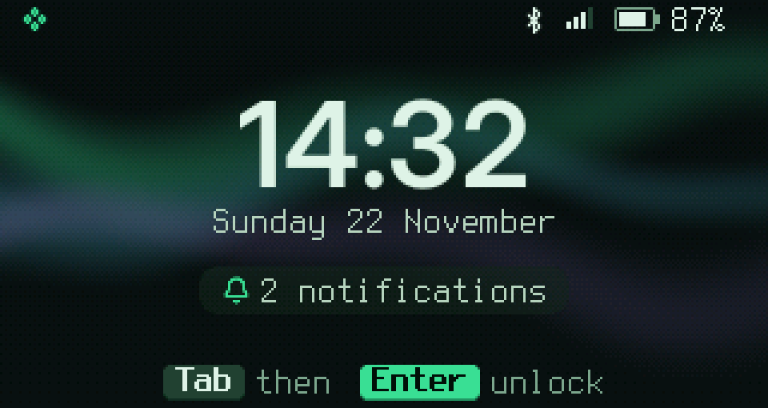
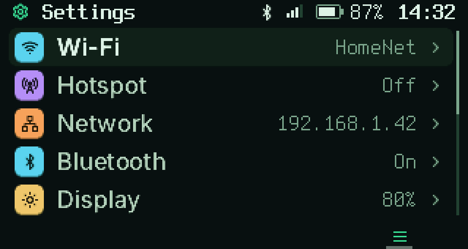
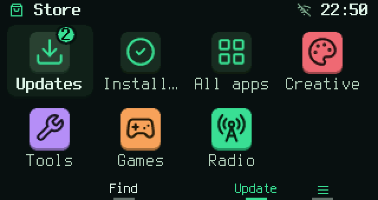
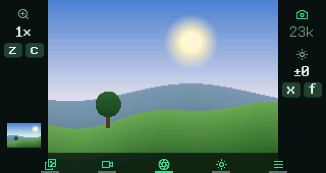
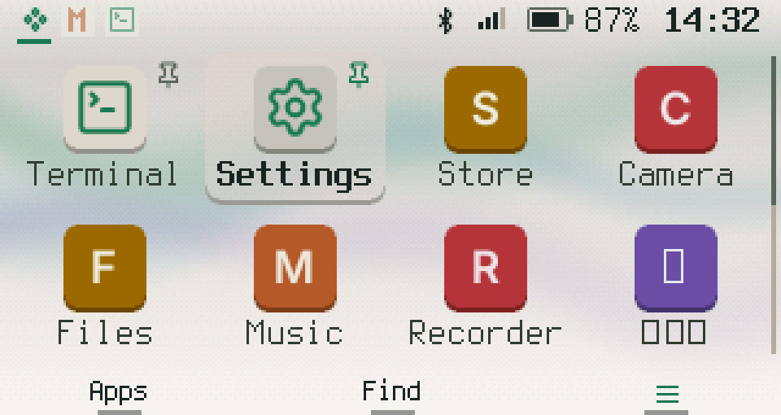

<div align="center">

# 👻 Gh0st OS

**A lean, private OS for the M5Stack CardputerZero.**
Faster than stock, private by default, and every CardputerZero app still runs.

[⬇️ Download v0.2.0 alpha](https://github.com/therezor/CardPuterZeroOS/releases/tag/v0.2.0) ·
[⚡ Flash in 5 minutes](#-flash-it) ·
[🧪 Tester notes](docs/alpha.md) ·
[🗺️ Roadmap](docs/roadmap.md)


</div>

## ✨ What you get

 

🎨 **A look made for 320x170.** Small text is Terminus, a pixel font that stays
sharp on the panel. Icons sit on coloured tiles, and each action sits right
above the key that runs it. Pick a wallpaper (Aurora, Contour or your own
photo) and a palette (Mint, Nord or Paper).

🔀 **Jump between apps.** Fn+K pauses the app in front and shows every open
app with the memory it uses. Go back to one where you left it, or close it.

🔍 **Find any app in a keystroke.** Press S and type. Pin favourites with P.
Show home as a grid or a list.

🔒 **A real lock screen.** Your password, the time large over your wallpaper,
and how many notifications wait, but never what they say. Keys pressed in a
pocket can't unlock it, because it takes Tab and then Enter.

🛍️ **Our own Store.** Browse CardputerZero apps by category, install, update
and remove them. The app list is signed, and the Store sends no account and
no device ID.

📷 **A new Camera.** Photos and video with zoom, exposure, a grid and a timer,
on the CardputerZero's camera.

⚙️ **Settings, a terminal and Updates, built in.** Wi-Fi, a Wi-Fi hotspot with
a QR code, Bluetooth, display, sound, look, time zone, SSH and logs, all from
the keyboard. The terminal has tabs, zoom and searchable history.

🔄 **Updates over the air.** The device checks once a day, tells you what it
found, and installs only when you say so. Your files and settings stay.

🧩 **Your apps keep working.** CardputerZero apps install and launch the way
they always have. Hold Esc to close one that hangs.

 

 

## 📊 Compared with stock

Measured on a CardputerZero. Stock is the M5Stack image with APPLaunch 0.6.105.

| | Stock | Gh0st OS |
|---|---|---|
| 🧠 Launcher memory | ❌ 9.6 MB | ✅ 2.1 MB |
| 💤 Launcher CPU, one idle minute | ❌ 5,430 ms | ✅ 0 to 10 ms |
| ⏰ Launcher wakeups, one idle minute | ❌ 35,026 | ✅ 12 to 24 |
| 🧵 Launcher threads | ❌ 14 | ✅ 1 |
| 🖥️ Full-screen redraws | ❌ 25 fps, tearing | ✅ 50.8 fps, no tearing |
| 💾 RAM used at idle | ❌ 216 MB, plus 93 MB in swap | ✅ About 140 MB, no swap |
| 🔋 Battery current, screen off | ❌ 305 mA, no saver | ✅ 212 mA with USB power saving |
| 🔐 SSH | ❌ On by default | ✅ Off until you turn it on |
| 📝 Logs | ❌ Kept on the SD card | ✅ Off until you turn them on |
| 📡 Name on the network | ❌ Announced over mDNS, sent when joining | ✅ Not announced, not sent |
| 🔄 Updates | ❌ Checks run on timers | ✅ Once a day, asks before it installs |
| 🧩 CardputerZero apps | ✅ Yes | ✅ Yes |

The sources for each number are in [docs/hardware-facts.md](docs/hardware-facts.md).

## ⚡ Flash it

You need a CardputerZero, a genuine microSD card of 8 GB or more, and
[Raspberry Pi Imager](https://www.raspberrypi.com/software/) 2.0.2 or later.
Flashing erases the card.

1. ⬇️ From the [v0.2.0 release](https://github.com/therezor/CardPuterZeroOS/releases/tag/v0.2.0),
   download `gh0st-release-DATE.img.xz`.
2. 🍓 In Imager, pick **Raspberry Pi Zero 2 W** as the device, then
   **Use custom** as the OS, and choose the `.img.xz`. Don't unpack it.
3. 💳 Pick the microSD card as the storage. Check its size, because Imager
   erases what you pick.
4. 🚫 When Imager offers OS customisation, answer **No**. Setup on the device
   does that job.
5. ✍️ Write, and let Imager verify.
6. 🔌 Put the card in the CardputerZero and power it on.

Setup starts within about 15 seconds. It teaches the keys in nine short
lessons (6 skips them), then asks for your country, time zone, privacy
choices, Wi-Fi, account and look. The full walk-through, checksums and known
issues are in the [tester notes](docs/alpha.md).

## ⌨️ Keys

| Key | Does |
|---|---|
| Enter / Esc | Open / back |
| 4 to 8 | The action named above the key. 8 opens the menu |
| F, Z, X, C or the Fn arrows | Move |
| S | Search |
| Fn+H | Help for the screen in front |
| Fn+K | Switch apps |
| Hold Esc | Close the app in front |
| Hold Tab | Lock |
| Tab, then Enter | Unlock |

The brightness, volume, mute and screenshot keys work everywhere, over apps
too.

## 🚧 Status

**v0.2.0 is an alpha.** It runs every day on our test device, but it can
still break, and the SDK and the design can still change. To report a bug,
open an issue with the Build from Settings > About. The
[tester notes](docs/alpha.md) list what else to include.

Next on the [roadmap](docs/roadmap.md): per-app limits on network and files,
a faster boot, and the key training as its own app.

## 🛠️ For developers

Gh0st OS is Debian 13, built from pinned inputs in a container
([docs/image-build.md](docs/image-build.md)). The shell, Settings, the
terminal, the Store, Updates and Camera are Rust. Each is a static binary of
1 to 2 MB with its fonts and icons built in, and each runs one thread with one
`poll` loop.

```sh
cargo test --workspace
cargo build --release --target aarch64-unknown-linux-musl   # static, no cross compiler
cargo run -p gh0st -- shell --sim DIR                       # the shell on any host
GH0ST_HOST=<user>@<device> scripts/deploy.sh                # install on a device
```

Under `--sim`, keys come from a script on stdin and frames land in DIR as
PNGs. Apart from the home screen, the screenshots above come from the
simulator.

- 📘 [docs/sdk.md](docs/sdk.md): write an app with the Gh0st SDK.
- 🎨 [docs/design.md](docs/design.md): the design system.
- 📦 [docs/apps.md](docs/apps.md): what the shell gives any app.
- 🔄 [docs/updates.md](docs/updates.md): the update engine and the apt repo.
- 🖥️ [docs/panel-driver.md](docs/panel-driver.md): how a frame reaches the panel.

## 📜 Licenses

The Rust code is MIT, see [LICENSE](LICENSE). The panel driver is GPL-2.0,
from M5Stack and Noralf Trønnes. Inter, JetBrains Mono and Terminus are under
the SIL Open Font License, and the Lucide icons under ISC. The mark is the
Tabler "components" icon, MIT.
