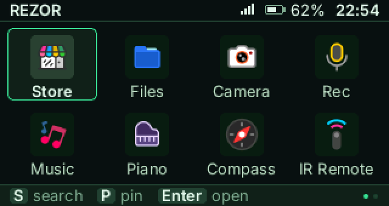
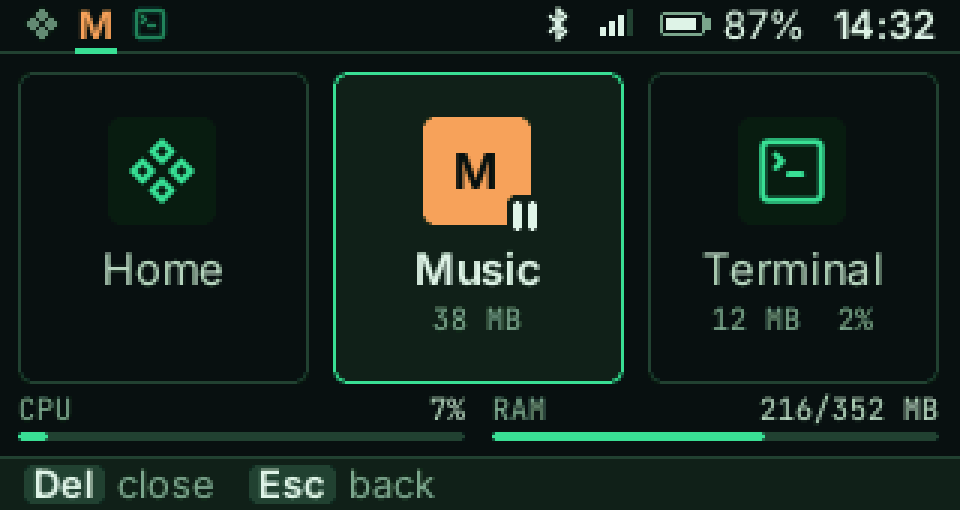

# CardPuterZeroOS

The CardputerZero OS it should have shipped with. Faster, private, a cleaner UI
and more features. Fully compatible with CardputerZero apps.



CardPuterZeroOS is Linux, built on Debian, the same base as the stock OS. So
every CardputerZero app runs as it is, and so does the Store. Today it installs
on the stock image and replaces its launcher. Its own lean Debian 13 image is
next.

## Why switch

**Light on the battery.** When you're not using it, the home screen does
almost nothing. The CPU sleeps, apps get the memory, and the battery isn't
spent on an idle menu.

**The screen never tears.** On stock, every app tears as it scrolls. Our panel
driver sends each frame in step with the screen, at a steady 50 frames a
second. Stock apps get this too.

**Jump between apps.** Fn+K pauses the app you're in and shows every open
app, with how much memory each one uses. Go back to one where you left it, or
close it with Del.

**Find any app in a keystroke.** Press S and type. Pin your favourites with P.
Show apps as a grid or a list, in the Mint, Nord or Paper theme.

**Settings and a terminal, built in.** Wi-Fi, Bluetooth, display, sound, look,
time zone, SSH and logs, all from the keyboard. The terminal has tabs, zoom and
history you can search. Both are new and not yet tested on the device.

**Your apps keep working.** Apps install and launch the way they always have.
Hold Esc for 3 seconds to close one that hangs.

**Safe to try.** One command installs it. One command puts stock back.

 

## Compared with stock

Measured on a CardputerZero. The first four rows are the launcher alone, over
one minute idle on the home screen. Stock is APPLaunch 0.6.105.

| | Stock OS | CardPuterZeroOS |
|---|---|---|
| Launcher memory | 9.6 MB | 1.3 MB |
| CPU time | 5,430 ms | 10 ms |
| Wakeups | 35,026 | 24 |
| Threads | 14 | 1 |
| Full-screen redraws | 40 fps, tearing | 50.8 fps, no tearing |
| CardputerZero apps and the Store | Yes | Yes |

## Coming with the CardPuterZeroOS image

The image is not built yet. Today you get the launcher and the panel driver on
top of stock, with stock's defaults. These change once the image ships.

| | Stock image | CardPuterZeroOS image |
|---|---|---|
| SSH | On by default | Off until you turn it on |
| Logs | Kept on the SD card | Off unless you turn them on in Settings |
| Cloud remote access | `rpi-connect` installed | Not installed |
| Your device on the network | Announced by name over mDNS | Not announced |
| Joining a network | Sends the name `cardputerzero` | Sends no name |
| Update checks | Run on timers | Only when you ask |
| Incoming connections | Accepted | Blocked by a firewall |

The stock column comes from our audit of the stock image, in
[docs/distro-plan.md](docs/distro-plan.md).

Also planned: a PIN on the lock screen, per-app limits on network and files,
signed updates and a faster boot. The full list is in [docs/roadmap.md](docs/roadmap.md).

## Keys

| Key | Does |
|---|---|
| F, Z, X, C or the Fn arrows | Move |
| Enter or a digit | Open an app |
| S | Search |
| P | Pin an app |
| Fn+K, or Tab at home | Switch apps |
| Del, in the switcher | Close an app |
| Hold Esc for 3 seconds | Close a stuck app |
| Hold Tab for 3 seconds | Lock the screen |

The brightness, volume, mute and screenshot keys work everywhere, over apps
too. At 3% battery the device counts down and powers off.

## Install

From a Mac or Linux machine with Rust and SSH access to the device:

```sh
GH0ST_HOST=<user>@<device> scripts/deploy.sh            # install
GH0ST_HOST=<user>@<device> scripts/deploy.sh rollback   # back to stock
```

The script installs `/usr/bin/gh0st` next to the stock launcher. A systemd
drop-in makes the stock `APPLaunch.service` start ours, so launcher upgrades
and the first-boot wizard keep working.

The panel driver builds on the device, against the running kernel:

```sh
cd os/kernel/panel-mipi-dbi-m && sudo ./install.sh   # then reboot
sudo ./install.sh uninstall                         # M5Stack's driver back
```

## Status

The launcher, the app switcher and the panel driver run on the device. Settings
and the terminal run in the simulator and are not yet tested on the device.

## For developers

The launcher is Gh0stdeck, written in Rust. It is one static binary of about
1 MB, with its fonts and icons built in, and it runs on one thread. It reads
the battery, network and clock when the kernel reports a change, so nothing
polls. How the panel driver times frames is in
[docs/panel-driver.md](docs/panel-driver.md).

```sh
cargo test --workspace
cargo build --release --target aarch64-unknown-linux-musl   # static binary
```

The release build links with the `rust-lld` that ships with rustup, so it
needs no cross compiler. `cargo run -p gh0st -- shell --sim DIR` runs the
shell on any host. Keys come from a script on stdin, and frames land in DIR
as PNGs. The screenshots above, apart from the home screen, come from the
simulator.

Apps for CardPuterZeroOS use the app SDK. The guide is [docs/sdk.md](docs/sdk.md),
and [docs/apps.md](docs/apps.md) covers what the launcher gives any app.

- `crates/gh0st-ui`: drawing, fonts, icons, widgets, themes.
- `crates/gh0st-core`: config, `.desktop` parsing, the keyboard map, the event
  loop and child processes.
- `crates/gh0st-shell`: the home screen and the shell process.
- `crates/gh0st-app`: the app SDK.
- `crates/gh0st-settings`: Settings.
- `crates/gh0st-term`: the terminal. The guide is
  [docs/terminal.md](docs/terminal.md).
- `crates/gh0st`: the `gh0st` binary.
- `os/kernel/panel-mipi-dbi-m`: the panel driver and its overlay.
- `docs/`: hardware facts, the panel driver, the app contract, the distro plan.

## Licenses

The Rust code is MIT, see [LICENSE](LICENSE). The panel driver is GPL-2.0, from
M5Stack and Noralf Trønnes. Inter, JetBrains Mono and Terminus are under the
SIL Open Font License, and the Lucide icons under ISC. The mark is the Tabler
"components" icon, MIT.
