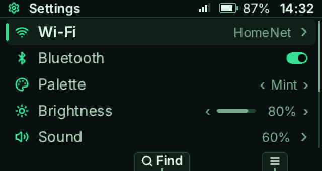
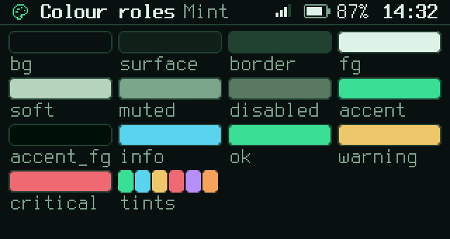
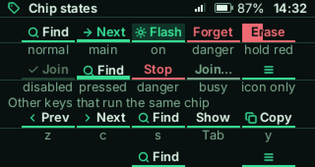
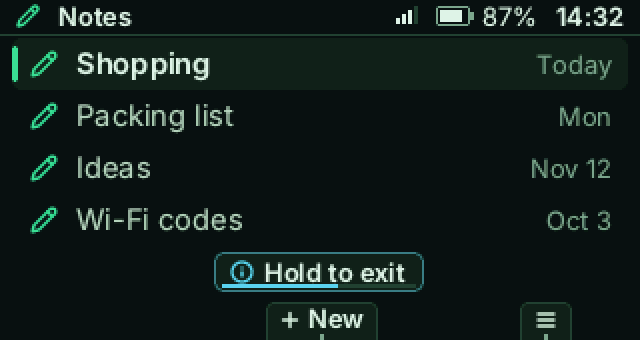
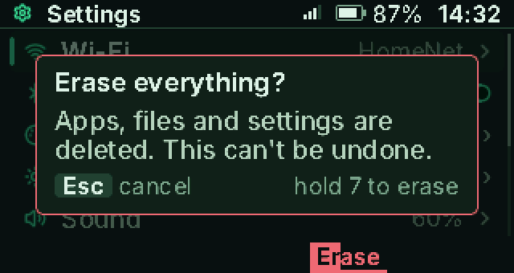
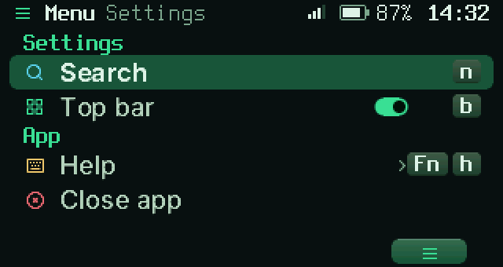
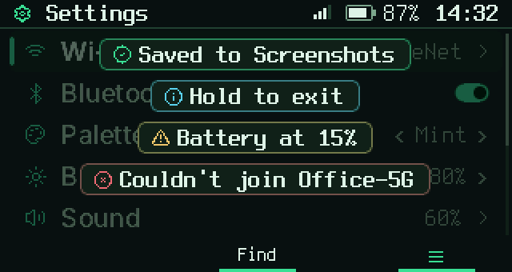
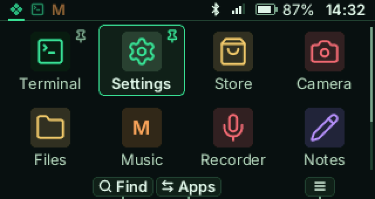

# Design system

One look and one set of keys for every screen: the shell, Settings, the
terminal and every SDK app. gh0st-ui draws each piece and the SDK puts them on
screen, so an app gets them by asking, not by drawing. Apps built on the
official [CardputerZero template](https://github.com/CardputerZero/Template)
keep working: the keys mean the same thing there.

The pictures come from `crates/gh0st-ui/examples/design.rs`, which renders
every screen below into `mockups/design` and these into `docs/design`:

```sh
cargo run -p gh0st-ui --example design
```

## Principles

- **The screen says what the keys do.** An action you can take sits above the
  key that runs it, or is named in a key pill.
- **A key means the same thing everywhere.** Esc goes back. Enter does the
  main thing. 8 opens the menu. Fn and H open help.
- **Enter and Esc need no chip.** Everyone knows them, so the bar spends its
  room on the actions you would not guess.
- **Nothing that loses data sits on Enter.** It sits on a chip you hold.
- **Cheap.** No new font faces, no timer while idle, nothing that polls.

## The frame



| Part | Height | What it holds |
|---|---|---|
| Top bar | 18 px | the page, then the device's state |
| Content | 132 px | the page |
| Action bar | 20 px | chips above keys 4 to 8, or key hints while typing |

A page may drop either bar. Games and the terminal while typing take the
whole 320x170. A full-screen page that keeps the menu on 8 can leave the
bottom right corner to its ≡ chip (`Bars::full`): a rail `rail_w` (47 px)
wide. The camera drops the top bar and lays the action bar over its
picture with nothing behind the chips (`Bars::over`): each casts a 1 px
shadow instead. The picture keeps all 170 rows and the icon
chips over 4 to 8 still name what each key does. Its 4:3 picture leaves a
47 px rail each side for zoom and light; nothing in the rails or on the
picture goes below the bar's top. With no top bar, it draws its own REC
mark over the picture.

The template spends 30 px on each bar and leaves 110 for content. We keep the
bars thin and match it where it counts: the same keys do the same things.

## Colour

Apps never pick colours. They name a role and the palette fills it, so every
palette works and an app looks like the rest of the device. The built-ins are
Mint, Nord and Paper, and the popular schemes: Catppuccin Mocha and Latte,
Dracula, Gruvbox Dark and Light, Rosé Pine and Rosé Pine Dawn, Solarized
Light and Tokyo Night. Each keeps its upstream colours, except a role moved a
step to pass the contrast rules below; the source says which. One more,
Phantom, is earned: finishing setup's training unlocks it (`theme::EARNED`).



| Role | For | Template |
|---|---|---|
| `bg` | the screen | body |
| `surface` | rows, chips, cards | card |
| `border` | lines, tracks, key pills, chip edges | border |
| `fg` | text | text |
| `soft` | labels not selected | |
| `muted` | values, notes, hints | |
| `disabled` | things that can't be used now | text_disabled |
| `accent`, `accent_fg` | focus, the main pill, on | primary |
| `info` | neutral notices | info |
| `ok` | done, saved | success |
| `warning` | take care, low battery | warning |
| `critical` | errors, loss of data | error |
| `tints` | six colours for app badges and charts | |

A **tone** is Info, Ok, Warning or Critical. Toasts, banners, tags and row
icons take a tone, not a colour.

Contrast is tested for every palette: `fg` on `bg` 7:1, `fg` on `surface` 4.5:1,
`muted` and `disabled` on `bg` 3:1, `accent_fg` on `accent` 4.5:1.

### Custom colour schemes

A scheme is a text file, `<Name>.palette`. The file name is the name Settings
shows. Yours go in `~/.config/cardputerzero/palettes/`; the ones we ship are
in `/usr/share/gh0st/palettes/`. To make one, in the Terminal:

```sh
mkdir -p ~/.config/cardputerzero/palettes
cp "/usr/share/gh0st/palettes/Solarized Dark.palette" \
    ~/.config/cardputerzero/palettes/Mine.palette
nano ~/.config/cardputerzero/palettes/Mine.palette
```

Over SSH works the same, once SSH is on. Then pick it in Settings >
Appearance > Palette: Enter lists every palette, Left and Right step through
them. Yours come after the built-ins.

A line is `role = #rrggbb`, and `#` starts a comment. `Solarized Dark`
writes out every role, so it is the one to copy. A scheme can also name only
what it changes, as `Dusk` does:

```
# Dusk: Nord with an orange accent
base = nord
accent = #f0a35e
accent_fg = #2e3440
tint1 = #f0a35e
```

`base` picks the built-in to start from, by its name in any case, Mint if
left out. Every role it does not set keeps the base's. The roles are the table above: `bg surface border
fg muted accent accent_fg info ok warning critical`, `tint1` to `tint6`, and
the terminal's `ansi0` to `ansi15` (black, red, green, yellow, blue, magenta,
cyan, white, then the bright eight). `soft` and `disabled` follow from the
rest.

A scheme whose text would not read is refused: `fg` under 4.5:1 on `bg` or
3:1 on `surface`, or `accent_fg` under 3:1 on `accent`. A refused file is
left out of the list, and if `gh0st.palette` names it, the device stays on
Mint. Aim for the built-ins' rules above, so hints and tones read too. A
built-in's name is taken: a file called `Dracula.palette` never shows.

Apps load a scheme when its name is picked. After editing the one in use,
pick another palette and back.

## Type

Eight styles. Names and titles are Inter; the small text is Terminus, a
bitmap face, so it stays sharp where an outline face would blur:

| Style | Face | For |
|---|---|---|
| Display | Inter 26 semibold | a clock, one big number |
| Title | Inter 19 semibold | a page's heading |
| Body strong | Inter 17 at 650 | the selected row, a dialog's title |
| Body | Inter 17 at 450 | rows, text |
| Label | Terminus 16 bold | key pills, the top bar, section heads |
| Caption | Terminus 16 | values, notes, hints |
| Chip | Terminus 12 bold | a chip's word |
| Mono | JetBrains Mono 12, a 7 px cell | readouts, figures |

Nothing is smaller than 15 px, with two exceptions. A chip's word is
Terminus 12 bold, so a word of seven letters fits over its key. Mono is
12 px, so a MAC address or a size fits beside its label in a readout. The
terminal's grid starts at Terminus 12 and its text size steps up from there
(`docs/terminal.md`). Body is fitted to the pixel grid, sharpened hard, and
given an S-curve on coverage, so stems keep a hard core with a thin fringe.

Terminus is a cell 8 px wide, wider than Inter at 15 px. A note in a
message wraps; a value that does not fit its row ends in an ellipsis.

## Icons

[Lucide](https://lucide.dev), baked by `build.rs` from `assets/icons`. To use a
new one, add its SVG there: an unknown name draws nothing.

| Size | For |
|---|---|
| 12 | the top bar, chips |
| 14 | rows, toasts |
| 16 | small badges |
| 26 | home tiles |
| 36 | messages |

At 16 px and under, an icon sits beside Terminus, so it is drawn near it: a
1.2 px stroke moved onto the pixel grid and sharpened, so straight strokes
are hard and curves keep a thin fringe. 14 px is the 12 px
icon with a pixel of room each side, since Lucide's grid does not divide
into 14. 26 and 36 keep smooth edges.

## Top bar


**Left: where you are.** The page's icon and name in Label style. On a deeper
page its parent follows in Caption: "Wi-Fi Settings". A step or a file goes
there too: "Account Setup 6 of 8". An app with sessions shows them as tabs,
the front one underlined, as the shell shows open apps.

**Right: the device.** Read from right to left:

1. The clock, 24 or 12 hour as `gh0st.clock` says.
2. The battery and its percent. It fills in `warning` at 20% and `critical`
   at 5%, where the percent turns `critical` too. A bolt shows while it
   charges.
3. The network: Wi-Fi bars, a cable, or a struck-out Wi-Fi when there is
   neither. While the hotspot runs, its radio tower, ahead of a cable, so
   it is never on unseen.
4. Bluetooth, while it is on.
5. A bell and a count while notifications wait. On the shell's screens only,
   until the OS bars draw over apps too.
6. One word of the app's own, in a tone, after a dot: "REC" while recording.

When the title does not fit, the parent goes first, then Bluetooth, then the
title shortens. The clock and the battery always stay.

Not in the top bar: Shift, Caps, Fn and Sym, because the keyboard has its own
lights.

## The action bar



The screen sits right over the number row. A chip is a pill at the
screen's bottom edge, right above its key, and pressing that key runs it.

| Key | Holds |
|---|---|
| 4 | nothing. It is Esc, for template apps. Home has no Esc and puts Apps here; the switcher puts All here, held; the camera puts Photos here, as a phone camera keeps its gallery bottom left; Files puts Mark here, with Copy, Paste and Cut beside it. Esc itself still goes back. |
| 5, 6, 7 | the page's own actions |
| 8 | the menu, an icon-only ≡ chip. The switcher has no menu and puts Close here. |

Chips spread across the bar, so a key is easy to find without looking. One
chip sits in the middle, on 6. Two go apart, on 5 and 7; of a pair (Prev and
Next, Less and More) the one that goes back is on the left. Three take 5, 6
and 7.

**No chip repeats Enter or Esc.** There is no Back, Open, Exit, Cancel, Save
or Pick chip. Enter opens or does the main thing; Esc goes back. Where that
needs saying, a dialog or message names them in key pills.

**What a chip is.** A word over its key, with an 18 px bar under it at the
screen's edge (`Metrics::chip_bar_w`). No fill behind it: the picture or
the page shows through. The word is in Chip style, Terminus 12 bold, so
seven letters fit in the key's 48 px. A chip with a word shows the word
alone; a chip with no word, the menu's ≡, shows its icon.

| State | Looks | For |
|---|---|---|
| normal | plain word, a muted bar | most actions |
| main, on | accent word, an accent bar | the page's main action, or a toggle that is on |
| danger | red word, a red bar | Forget, Stop, Close |
| danger, held | the bar runs the chip's width and fills red | Erase, close all apps: hold it 0.7 s |
| armed | red word, a thicker red bar | pressed once, press again |
| disabled | faint word, a `border` bar | can't be used now; the key does nothing |
| pressed | the bar thickens, the word drops a row | while its key is down |
| busy | the word and "…", muted | working: no second press |

Rows change the chips. On a choice row, 5 and 7 read Prev and Next and z and
c do the same; on a level row they read Less and More.


### While typing


A text field takes the digits, so no chip can run. The bar turns into key
hints instead: key pills and what they do, on the page's ground. The main
key's pill is filled, as a main chip is. "Fn h help" sits on the right while
it fits.

### Raw pages

The terminal while typing takes every key. It shows no bar. On entry it
says once how to reach Esc and help.

## Keys

| Keys | Does |
|---|---|
| Esc | back one step: out of a sheet, out of the menu, up a page |
| Esc, held 0.7 s on an app's first page | exit the app |
| Esc, held 3 s | the shell closes the app, for one that hangs |
| Enter | open, or the main thing |
| Tab | the next field |
| 5, 6, 7 | the chips |
| 8 | the menu |
| f x z c, or Fn and F X Z C | up, down, left, right (letters only when not typing) |
| Fn and L, M | page up, page down |
| Fn and H | help: every key on this page |
| Fn and K | switch apps |
| Tab, held 3 s on home or in the switcher | lock |
| Tab, then Enter, on the lock screen | unlock, or the password |
| Fn and J | screenshot |
| Fn and Esc | the Esc key itself, for vim and the like |

A tap of Esc on an app's first page shows "Hold to exit". Holding it fills a
bar along the toast's foot; at 0.7 s the app closes. The hold starts only on a
press that began on the first page, so holding Esc through a Back never
quits. If the app does not answer, the shell's banner appears at 1.5 s and it
closes the app at 3 s.



Key pills name keys as the keycaps print them: Esc, Enter, Tab, Fn, Sym.
Letters are lowercase; an uppercase letter means Shift and that letter.

## Lists and rows

The selected row is `surface` standing on a 1 px foot. A settings row's
icon sits on a raised square of its own tint, dark or light ink as reads
best, and an icon keeps its tint on every
page (`Palette::icon_tint`). What a row shows on its right says what it is:

| Right side | Means |
|---|---|
| › | opens a page |
| a value and › | opens a page about that value |
| a value | read only |
| a switch | on or off; Enter flips it |
| ‹ value › | one of a few; Prev and Next, or Enter for the full list |
| ‹ bar % › | a level; Less and More |
| bars and a lock | a Wi-Fi network |
| ✓ | the one picked |
| a tag | a count or a word in a tone: "3", "New" |
| "Press again" in `warning` | armed: press once more to do it |

A row that can't be used now is drawn in `disabled` and says why on its
right. A row may have a second line in Caption. A row marked for an action
on many, as files to copy, has a pale `accent` wash and an `accent` check in
place of its icon.

Long lists stop at their ends; short ones wrap. PgUp and PgDn move a screen. Sections start with a heading
in Label style, in `accent`.

Fields have a label above in Caption. The focused one has an `accent` edge.
One with an error has a `critical` edge and says what is wrong under it.

A message fills the content: a 36 px icon, a line in Body strong, a note in
Caption, and, when Enter does something, its key pill. Empty lists and errors
use it.

Progress is a 4 px bar with a label and a percent. When there is no percent a
segment moves along it, and only while it is on screen.

## Surfaces

Depth comes from a ledge, not lines or shadows. A thing that stands up is
flat colour on a darker foot (`theme::foot`): 2 px under an app badge, a
selected tile or card, a dialog and a toast (`Metrics::lift`); 1 px under
a settings row's icon, a selected row, a key pill and a tag
(`Metrics::chip_lift`). What is selected stands up off the page; nothing
draws a ring around it. Only the selected tile or card stands: the rest
sit flat on the page. Corners are
round and smoothed: 4 px on rows and chips, 5 on app badges, 6 on tiles
and panes, 7 on cards, 2 on key pills. Every effect is a flat fill, a fill
that steps from one colour to another, or a picture baked once: nothing
blurs or polls per frame.

## Wallpaper

Home, the switcher, the notifications and the lock screen stand on a
picture; apps and Settings stand on `bg`. `gh0st.wallpaper` names it:
`aurora` (the default) or `contour`, drawn from the palette's colours, so
they change with it; `picture`, the user's own; or `off`.

The picture is baked once, when the shell starts or the picture or the
palette changes, into three buffers the screen's size: home's, the lock's
and a frost. A frame copies them and never blends a picture.

- **Home** keeps at most 65% of the picture, mixed toward `bg`, and less
  where needed, so `fg` reads at 6:1 on its brightest pixel.
- **The lock** keeps up to 85%, so `fg` reads at 4.5:1, and darkens a halo
  behind the clock.
- Both darken toward `bg` under the bars.
- **The frost** is the picture blurred and mostly `surface`. Panes show
  it: chips, the selected tile, a switcher card, the lock's note.

The bake dithers to RGB565, so a soft gradient doesn't band. It takes
about 100 ms on the device, so the shell keeps the result in
`~/.cache/gh0st/wallpaper.bin`, named by the picture and the palette; a
start reads it back in under 3 ms.

Settings > Appearance > Wallpaper steps through them. Your picture lists
the PNGs in ~/Pictures; Enter on one makes it the wallpaper.

A picture of the user's own is cropped to the screen's shape, from its
middle, when it is picked. Settings runs the crop in a child of its own
(`gh0st-settings --import-wallpaper`), so the page never waits on it. The source is read a row at a time and only the
320x170 crop is kept, beside config.json as `wallpaper.png`, so a large
photo never sits in memory. The shell refuses a kept file of any other
size.

## Dialogs


A card over the page. The content behind it dims; the bars do not. It has a
title in Body strong and a body. Esc and Enter are named in key pills, inside
the card or in the hint bar while a field has focus. Other actions are chips.
A field too long for the card shows its end, where typing goes on.



Asking first:

- **Press again**, in the row, for a step that is a nuisance to undo: forget a
  network.
- **A dialog** when the user should read before deciding: unsaved changes.
- **A held chip** for loss that can't be undone: erase the device, close all
  apps. Enter does nothing there.

## The menu and help



8 opens the app's menu over the page: its commands, grouped, with their keys
in pills on the right. The SDK adds Help and Close app at the end. While the
menu is open its chip on 8 is lit, and 8 closes it.


Fn and H open help: what the chips do, what the keys do, and the keys that
work everywhere. From help, 8 opens the menu, so a raw page or a focused
field can still reach it. Esc steps back one level at a time: help, then the
menu, then the page.

## Feedback



- **Toast.** A short line in a card that floats above the chips, with a
  tone's icon, for 2 s. It never covers the chips.
- **Busy.** A change the user waits for: a root helper, a radio, the
  hotspot starting. After 0.3 s the page dims under a card that says what
  is happening, with a segment moving along a bar. Keys wait and the chips
  go blank, so a second press can't start it again; Esc hides the card and
  the work goes on. The toast says how it went. Quicker changes never show
  it. A Wi-Fi join keeps "Joining…" in its row instead: it can take 45 s.
- **Banner.** The shell's urgent word, in a tone's colour. It takes the top
  bar's place while it shows, so the page does not move: "Battery 3%:
  powering off in 30 s".
- **Level.** The volume and brightness keys show the level in the top bar's
  place for 1.5 s.
- **Sound.** Short notes of one key (A major), soft and below a third of
  full scale: the amplifier is loud. A tick when the selection moves, a
  rising blip to choose or open, a falling one to go back or close, a
  rising chord to unlock and a falling one to lock, a low double buzz for a
  wrong password, two bell notes for a notice, three beeps for a low
  battery, and a chord at power on. Typing, a raw-key page and the dark
  make none. Settings > Sound > System sounds turns them off.

## Home and the switcher



Home: 4 Apps, 6 Find, 8 the home menu (pin, layout, notifications). Enter
opens the app. A tile carries a count from its app's notice: how many
updates, or how many notices.


The switcher: 4 All is held: its chip fills red, and at 0.7 s every app
closes. Del held on Home does the same. A shorter press shows "Hold to close
all". 6 Lock locks. 8 Close closes the selected app at once, and so does Del.
All and Close sit at the two ends, so one is never pressed for the other, and
nothing sits next to Close. While notifications wait, 5 shows a bell and how
many, and opens them.

## Notifications

A notice arrives as a toast over whatever is in front, with its app's
picture and name. It then waits in the notifications, opened from the
switcher's 5 or home's menu: newest first, each with its app, title, a line
under it and its age. Enter opens the app and clears the notice. 8 Clear
clears the selected one, as Del does. 4 held clears them all, as in the
switcher. The lock screen shows only how many.

## The lock screen

The device lives in a pocket, so no key typed by accident may reach an app or
the password once it is locked. The lock screen rests until Tab, then Enter,
are pressed in turn. Nothing else does anything there.

The top bar shows the battery and the network, but no open apps (what runs
stays private) and no clock. The time sits large in the middle instead, in
Inter at 50 px, with the date under it in Caption. How many notifications
wait sits on a pane under the date, with a bell.

- **At rest.** "Tab then Enter unlock" in key pills. Tab, then Enter within
  2 s, unlocks, or opens the password field when one is asked. Any other key
  in between starts over. When the account has no password, a note in
  Caption says "No password set".
- **The password field.** Focused, so the bottom bar shows key hints: Enter
  unlock, Esc back. Each key shows a dot. A wrong password empties the field,
  gives it a `critical` edge and says "Wrong password" under it. After three
  wrong tries the field waits: "Try again in 5 s", counting down. The wait
  doubles with each wrong try after that, up to 5 minutes. Esc, or 10 s without a key, wipes
  it and goes back to rest.

It asks for the password when Settings > System > Unlock with password is on
and the account has one.

It locks:

- when Tab is held 3 s on home or in the switcher;
- from Lock in the home menu, or 6 Lock in the switcher;
- at start, when a password is asked;
- when the screen was dark longer than Lock after (Settings > System, 5
  minutes by default; At once locks on every dark, By hand never).

A key after a shorter dark goes straight back to home, the switcher or the
app. That key does nothing else, even held. Inside the window, a pocket can
press keys on an unlocked device.

At rest it goes dark again after 10 s without a key (sooner when Screen off
after is shorter, never when it is Never), so a pocket keeps it lit only
briefly. The brightness, volume and screenshot keys work on it, and the
low battery banner shows. Toasts from apps don't.

## Dark

After Screen off after (Settings > Display, 30 s by default) with no key, the
backlight dims to 10% for 5 s, then goes off. A key during the dim brings it
back, and the page gets that key as usual.

While dark, the app in front is paused as Fn+K pauses it, unless it may run in
the background. The shell draws nothing and runs no timer. A key wakes the
screen, and no app sees that key. Past Lock after it wakes on the lock screen
at rest; before, straight back. An app can ask to stay
awake (`sdk.md`, `keep_awake`), for a player or a clock.

Two more savers, each its own setting:

- **Wi-Fi off in the dark** (Display: Never, or after 1, 5 or 15 minutes).
  The radio goes off that long into the dark and comes back on wake, so SSH
  and downloads stop meanwhile. About 28 mA. It never turns on a radio the
  user left off.
- **USB power saving** (System > Advanced, on by default). The built-in
  Ethernet chip suspends while it has no work, and with it the whole USB
  bus: about 93 mA, with the screen on too. A USB device that can't suspend
  keeps the bus awake, so unplug dongles that aren't in use.

## Words

- One word on a chip, five letters or fewer when the bar is full.
- Sentence case for titles and rows: "Close app", not "Close App".
- Hints are lowercase: "Esc cancel".
- Say what happens: "Hold to exit", "Press again".

## Template apps

| Template | Here |
|---|---|
| Title bar, 30 px, title and status | Top bar, 18 px |
| Five icon buttons over 4 to 8, ESC = 4 | Chips over 5 to 8; 4 is still Esc |
| Hold 4 or ESC on the first page to exit | Hold Esc 0.7 s |
| Fn and H, help popup | Fn and H, help |
| Fn and J, screenshot | the same |
| Naive UI colours, light and dark | roles in Mint, Nord and Paper |

## Not built yet

- Home's Find still types into the bottom bar; the field at the top with a
  hint bar (screen 35) is still to come.
- The terminal's scroll and find modes keep their own hint bar: it takes
  every key raw, so the SDK's chips don't run there yet.
- Some sizes still sit in widgets as literals: the card's padding, the
  toast's insets, the dialog's layout. They belong in `Metrics`.

- Marks for the camera, mic and an SSH session in use. inotify can't tell who
  opened a device, and there is no polling, so they wait for a better source.
- Fn and a digit (F4 to F8) is unmeasured on the device.
- Chip centres over the keys need a check on the device: the template's
  centres differ from ours by up to 7 px.
