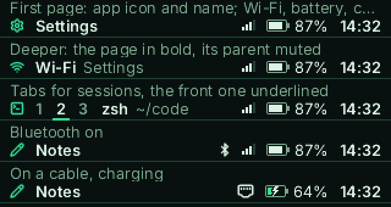
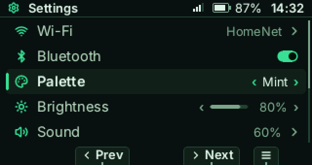
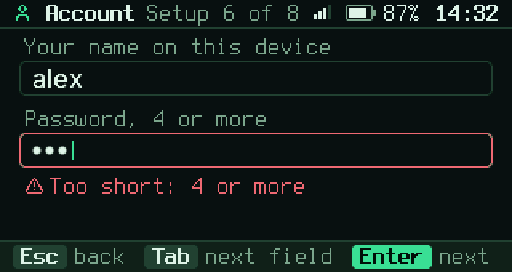
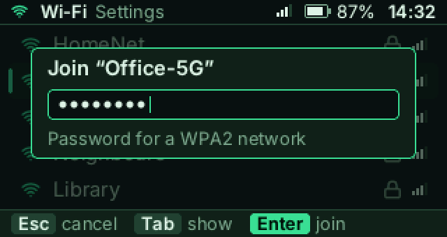
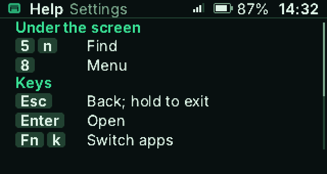
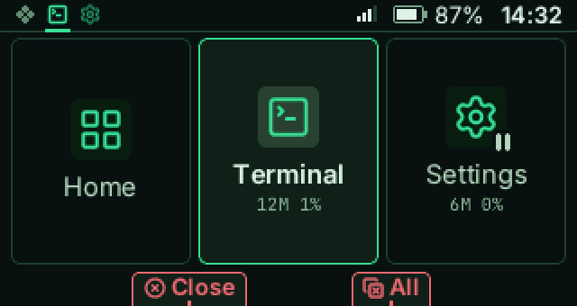

# Design system

One look and one set of keys for every screen: the shell, Settings, the
terminal and every SDK app. gh0st-ui draws each piece and the SDK puts them on
screen, so an app gets them by asking, not by drawing. Apps built on the
official [CardputerZero template](https://github.com/CardputerZero/Template)
keep working: the keys mean the same thing there.

The pictures come from `crates/gh0st-ui/examples/design.rs`, which renders
every screen below into `mockups/design` and these into `docs/design`:

```sh
cargo run -p gh0st-ui --example design
```

## Principles

- **The screen says what the keys do.** An action you can take sits above the
  key that runs it, or is named in a key pill.
- **A key means the same thing everywhere.** Esc goes back. Enter does the
  main thing. 8 opens the menu. Fn and H open help.
- **Enter and Esc need no chip.** Everyone knows them, so the bar spends its
  room on the actions you would not guess.
- **Nothing that loses data sits on Enter.** It sits on a chip you hold.
- **Cheap.** No new font faces, no timer while idle, nothing that polls.

## The frame


| Part | Height | What it holds |
|---|---|---|
| Top bar | 18 px | the page, then the device's state |
| Content | 132 px | the page |
| Action bar | 20 px | chips above keys 4 to 8, or key hints while typing |

A page may drop either bar. The camera, games and the terminal while typing
take the whole 320x170.

The template spends 30 px on each bar and leaves 110 for content. We keep the
bars thin and match it where it counts: the same keys do the same things.

## Colour

Apps never pick colours. They name a role and the palette fills it, so Mint,
Nord and Paper all work and an app looks like the rest of the device.


| Role | For | Template |
|---|---|---|
| `bg` | the screen | body |
| `surface` | rows, chips, cards | card |
| `border` | lines, tracks, key pills, chip edges | border |
| `fg` | text | text |
| `soft` | labels not selected | |
| `muted` | values, notes, hints | |
| `disabled` | things that can't be used now | text_disabled |
| `accent`, `accent_fg` | focus, the main pill, on | primary |
| `info` | neutral notices | info |
| `ok` | done, saved | success |
| `warning` | take care, low battery | warning |
| `critical` | errors, loss of data | error |
| `tints` | six colours for app badges and charts | |

A **tone** is Info, Ok, Warning or Critical. Toasts, banners, tags and row
icons take a tone, not a colour.

Contrast is tested for every palette: `fg` on `bg` 7:1, `fg` on `surface` 4.5:1,
`muted` and `disabled` on `bg` 3:1, `accent_fg` on `accent` 4.5:1.

### Custom colour schemes

A scheme is a file of roles, `<name>.palette`, in
`~/.config/cardputerzero/palettes/` or `/usr/share/gh0st/palettes/`. Settings
lists it after the built-ins, and `gh0st.palette` names it as it names Mint.

```
# Dusk: Nord with an orange accent
base = nord
accent = #f0a35e
accent_fg = #2e3440
tint2 = #d08770
```

`base` picks the built-in to start from, Mint if left out. Every role it
does not set keeps the base's: `bg surface fg muted accent accent_fg info
warning critical ok border`, `tint1` to `tint6`, `ansi0` to `ansi15`.
`soft` and `disabled` follow from the rest. A scheme whose text would not
read (`fg` under 4.5:1 on `bg`, or `accent_fg` under 3:1 on `accent`) is
refused, and the device stays on Mint.

## Type

Seven styles, all from faces the device already has baked:

| Style | Face | For |
|---|---|---|
| Display | Inter 24 semibold | a clock, one big number |
| Title | Inter 17 semibold | a page's heading |
| Body strong | Inter 15 semibold | the selected row, a dialog's title |
| Body | Inter 15 | rows, text |
| Label | Inter 13 semibold | chips, key pills, the top bar, section heads |
| Caption | Inter 13 | values, notes, hints |
| Mono | JetBrains Mono 10 | readouts, figures |

## Icons

[Lucide](https://lucide.dev), baked by `build.rs` from `assets/icons`. To use a
new one, add its SVG there: an unknown name draws nothing.

| Size | For |
|---|---|
| 12 | the top bar, chips |
| 14 | rows, toasts |
| 16 | small badges |
| 26 | home tiles |
| 36 | messages |

## Top bar



**Left: where you are.** The page's icon and name in Label style. On a deeper
page its parent follows in Caption: "Wi-Fi Settings". A step or a file goes
there too: "Account Setup 7 of 10". An app with sessions shows them as tabs,
the front one underlined, as the shell shows open apps.

**Right: the device.** Read from right to left:

1. The clock, 24 or 12 hour as `gh0st.clock` says.
2. The battery and its percent. It fills in `warning` at 20% and `critical`
   at 5%, where the percent turns `critical` too. A bolt shows while it
   charges.
3. The network: Wi-Fi bars, a cable, or a struck-out Wi-Fi when there is
   neither.
4. Bluetooth, while it is on.
5. One word of the app's own, in a tone, after a dot: "REC" while recording.

When the title does not fit, the parent goes first, then Bluetooth, then the
title shortens. The clock and the battery always stay.

Not in the top bar: Shift, Caps, Fn and Sym, because the keyboard has its own
lights.

## The action bar


The screen sits right over the number row. A chip is a tab standing on the
screen's bottom edge, right above its key, and pressing that key runs it.

| Key | Holds |
|---|---|
| 4 | nothing. It is Esc, for template apps. Home has no Esc and puts Apps here. |
| 5, 6, 7 | the page's own actions |
| 8 | the menu, an icon-only ≡ chip |

Chips spread across the bar, so a key is easy to find without looking. One
chip sits in the middle, on 6. Two go apart, on 5 and 7; of a pair (Prev and
Next, Less and More) the one that goes back is on the left. Three take 5, 6
and 7.

**No chip repeats Enter or Esc.** There is no Back, Open, Exit, Cancel, Save
or Pick chip. Enter opens or does the main thing; Esc goes back. Where that
needs saying, a dialog or message names them in key pills.

**What a chip is.** A 19 px tab, its top corners rounded 3 px, edged on its
top and sides and square and open at the foot, where the screen ends. A short tick at its foot
sits over the centre of its key. A 12 px icon and one word in Label style,
7 px clear on each side. A word is never cut. When two
neighbours crowd each other they share the squeeze, down to 4 px each side;
past that a chip drops its icon. Words of five letters or fewer keep their
icons on a full bar.

| State | Looks | For |
|---|---|---|
| normal | `surface` with a `border` edge | most actions |
| on | a pale accent fill | a toggle that is on: Flash |
| danger | a `critical` edge and word | Forget, Stop, Close |
| danger, held | fills `critical` left to right | Erase: hold it 0.7 s |
| main | `accent` fill | an action that is the page's main one but not on Enter |
| disabled | no fill, `disabled` word | can't be used now; the key does nothing |
| pressed | `fg` fill | while its key is down |
| busy | the word and "…" | working: no second press |

Rows change the chips. On a choice row, 5 and 7 read Prev and Next and z and
c do the same; on a level row they read Less and More.



### While typing



A text field takes the digits, so no chip can run. The bar turns into key
hints instead: a `surface` strip with key pills and what they do. The main
key's pill is filled, as a main chip is. "Fn h help" sits on the right while
it fits.

### Raw pages

The terminal while typing takes every key. It shows no bar. On entry it
says once how to reach Esc and help.

## Keys

| Keys | Does |
|---|---|
| Esc | back one step: out of a sheet, out of the menu, up a page |
| Esc, held 0.7 s on an app's first page | exit the app |
| Esc, held 3 s | the shell closes the app, for one that hangs |
| Enter | open, or the main thing |
| Tab | the next field |
| 5, 6, 7 | the chips |
| 8 | the menu |
| f x z c, or Fn and F X Z C | up, down, left, right (letters only when not typing) |
| Fn and L, M | page up, page down |
| Fn and H | help: every key on this page |
| Fn and K | switch apps |
| Fn and J | screenshot |
| Fn and Esc | the Esc key itself, for vim and the like |

A tap of Esc on an app's first page shows "Hold to exit". Holding it fills a
bar along the toast's foot; at 0.7 s the app closes. The hold starts only on a
press that began on the first page, so holding Esc through a Back never
quits. If the app does not answer, the shell's banner appears at 1.5 s and it
closes the app at 3 s.


Key pills name keys as the keycaps print them: Esc, Enter, Tab, Fn, Sym.
Letters are lowercase; an uppercase letter means Shift and that letter.

## Lists and rows

The selected row has a `surface` fill and a 3 px accent bar on the left.
What a row shows on its right says what it is:

| Right side | Means |
|---|---|
| › | opens a page |
| a value and › | opens a page about that value |
| a value | read only |
| a switch | on or off; Enter flips it |
| ‹ value › | one of a few; Prev and Next, or Enter for the full list |
| ‹ bar % › | a level; Less and More |
| bars and a lock | a Wi-Fi network |
| ✓ | the one picked |
| a tag | a count or a word in a tone: "3", "New" |
| "Press again" in `warning` | armed: press once more to do it |

A row that can't be used now is drawn in `disabled` and says why on its
right. A row may have a second line in Caption. Sections start with a heading
in Label style, in `accent`.

Fields have a label above in Caption. The focused one has an `accent` edge.
One with an error has a `critical` edge and says what is wrong under it.

A message fills the content: a 36 px icon, a line in Body strong, a note in
Caption, and, when Enter does something, its key pill. Empty lists and errors
use it.

Progress is a 4 px bar with a label and a percent. When there is no percent a
segment moves along it, and only while it is on screen.

## Dialogs



A card over the page. The content behind it dims; the bars do not. It has a
title in Body strong and a body. Esc and Enter are named in key pills, inside
the card or in the hint bar while a field has focus. Other actions are chips.


Asking first:

- **Press again**, in the row, for a step that is a nuisance to undo: forget a
  network.
- **A dialog** when the user should read before deciding: close all apps,
  unsaved changes.
- **A held chip** for loss that can't be undone: erase the device. Enter does
  nothing there.

## The menu and help


8 opens the app's menu over the page: its commands, grouped, with their keys
in pills on the right. The SDK adds Help and Close app at the end. While the
menu is open its chip on 8 is lit, and 8 closes it.



Fn and H open help: what the chips do, what the keys do, and the keys that
work everywhere. From help, 8 opens the menu, so a raw page or a focused
field can still reach it. Esc steps back one level at a time: help, then the
menu, then the page.

## Feedback


- **Toast.** A short line in a card that floats above the chips, with a
  tone's icon, for 2 s. It never covers the chips.
- **Banner.** The shell's urgent word, in a tone's colour. It takes the top
  bar's place while it shows, so the page does not move: "Battery 3%:
  powering off in 30 s".
- **Level.** The volume and brightness keys show the level in the top bar's
  place for 1.5 s.

## Home and the switcher


Home: 4 Apps, 6 Find, 8 the home menu (pin, layout). Enter opens the app.



The switcher: 5 Close closes the selected app at once. 7 All asks first, in a
dialog, then closes every app. They sit apart, so one is never pressed for
the other.

## Words

- One word on a chip, five letters or fewer when the bar is full.
- Sentence case for titles and rows: "Close app", not "Close App".
- Hints are lowercase: "Esc cancel".
- Say what happens: "Hold to exit", "Press again".

## Template apps

| Template | Here |
|---|---|
| Title bar, 30 px, title and status | Top bar, 18 px |
| Five icon buttons over 4 to 8, ESC = 4 | Chips over 5 to 8; 4 is still Esc |
| Hold 4 or ESC on the first page to exit | Hold Esc 0.7 s |
| Fn and H, help popup | Fn and H, help |
| Fn and J, screenshot | the same |
| Naive UI colours, light and dark | roles in Mint, Nord and Paper |

## Not built yet

- Home's Find still types into the bottom bar; the field at the top with a
  hint bar (screen 35) is still to come.
- The terminal's scroll and find modes keep their own hint bar: it takes
  every key raw, so the SDK's chips don't run there yet.
- Two-line rows are in gh0st-ui (`note_row`) but not yet in the SDK's
  `Ui::list`, which keeps one row height.
- Some sizes still sit in widgets as literals: the card's padding, the
  toast's insets, the dialog's layout. They belong in `Metrics`.

- Marks for the camera, mic and an SSH session in use. inotify can't tell who
  opened a device, and there is no polling, so they wait for a better source.
- Fn and a digit (F4 to F8) is unmeasured on the device.
- Chip centres over the keys need a check on the device: the template's
  centres differ from ours by up to 7 px.
